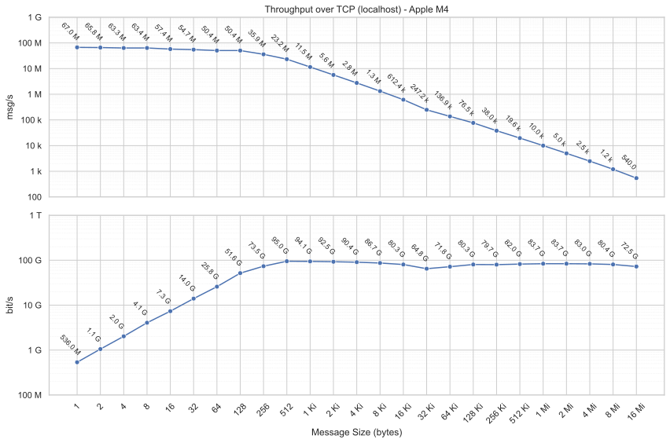
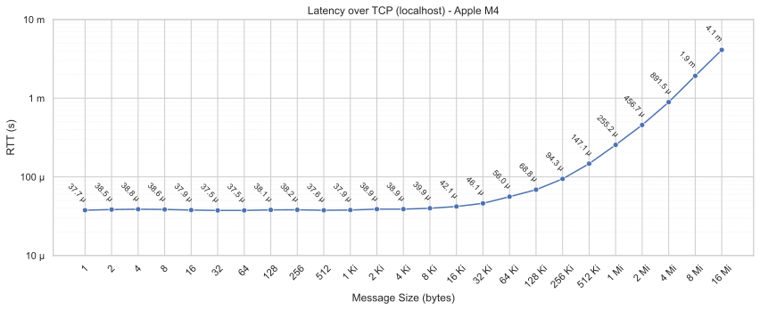

# Thubo

[](https://github.com/Mallets/thubo/actions?query=workflow:CI+branch:main)
[](https://docs.rs/thubo/latest/thubo/)
[](https://crates.io/crates/thubo)
[](https://choosealicense.com/licenses/epl-2.0/)
[](https://opensource.org/licenses/Apache-2.0)

Thubo is a high-performance TX/RX network pipeline featuring strict priority scheduling, automatic batching, and message fragmentation. It’s designed for applications that require predictable, priority-based message delivery, even under heavy load.

This is especially useful for protocols prone to head-of-line blocking (e.g., TCP/TLS), where a single large, low-priority message might otherwise delay urgent messages.

## Why Thubo?

- ⚡ **Strict Priority Scheduling**: high-priority messages preempt lower-priority flows.
- 📦 **Automatic Batching**: maximizes throughput without manual tuning.
- 🔀 **Message Fragmentation**: prevents head-of-line blocking by splitting large messages.
- ⚙️ **Configurable Congestion Control**: do not block on data that may get stale.

## Overview

The diagram below illustrates the TX/RX network pipeline in operation, using all 4 priority queues (*High, Medium, Low, Background*).

```text
                                                              .....
 APPLICATION SEND                                     User code   :
┌─────────────┐  ┌────┐  ┌────────┐  ┌────┐  ┌────┐               :
│    B1       │  │ L1 │  │ M1     │  │ H1 │  │ H2 │               :
└──┬──────────┘  └─┬──┘  └──┬─────┘  └─┬──┘  └─┬──┘               :
  t0              t1       t2         t3      t4                  :
   ▼               ▼        ▼          ▼       ▼                  :
~~~~~~~~~~~~~~~~~~~~~~~~~~~~~~~~~~~~~~~~~~~~~~~~~~~~~~~~~~~~~~~~  :
 TX PIPELINE                                 Thubo code           :
┌──────────────────────────────────────────────────────────────┐  :
│  Queues:                                                     │  :
│   P0 (High):       [H1][H2]           ← t3 ← t4              │  :
│   P1 (Medium):     [M1a, M1b]         ← t2                   │  :
│   P2 (Low):        [L1a, L1b]         ← t1                   │  :
│   P3 (Background): [B1a, B1b, B1c]    ← t0                   │  :
|                                                              |  :
│              t0     t1   t2   t3 t4                          │  :
│  Pull Order: B1a → B1b → L1a → M1a → H1 H2 → M1b → L1b → B1c │  :
│                                                              │  :
│  TX Stream: [B1a][B1b][L1a][M1a][H1 H2][M1b][L1b][B1c]       │  :
└───────────┬──────────────────────────────────────────────────┘  :
            |                                                 .....
            ▼ Network
                                                              .....
 RX PIPELINE                                         Thubo code   :
┌──────────────────────────────────────────────────────────────┐  :
│  RX Stream: [B1a][B1b][L1a][M1a][H1 H2][M1b][L1b][B1c]       │  :
│                                                              │  :
│  Reassembled Messages: B1, L1, M1, H1, H2                    │  :
│                                                              │  :
│  Delivered by Priority: H1 → H2 → M1 → L1 → B1               │  :
└───────────┬──────────────────────────────────────────────────┘  :
            ▼                                                     :
~~~~~~~~~~~~~~~~~~~~~~~~~~~~~~~~~~~~~~~~~~~~~~~~~~~~~~~~~~~~~~~~  :
 APPLICATION RECEIVE                                  User code   :
┌────┐ ┌────┐ ┌────────┐ ┌────┐ ┌─────────────┐                   :
│ H1 │ │ H2 │ │ M1     │ │ L1 │ │    B1       │                   :
└────┘ └────┘ └────────┘ └────┘ └─────────────┘                   :
                                                              .....
```

See documentation for a more detailed explaination.

## Quick Start

```rust
use thubo::*;
use tokio::net::TcpStream;

#[tokio::main]
async fn main() -> Result<(), Box<dyn std::error::Error>> {
    // Create a TCP connection
    let stream = TcpStream::connect("127.0.0.1:8080").await?;
    let (reader, writer) = stream.into_split();

    // Create bidirectional Thubo channel
    let (mut sender, sender_task) = thubo::sender(writer).build();
    let (mut receiver, receiver_task) = thubo::receiver(reader).build();

    // Send a message with default QoS
    sender.send(Bytes::from("my payload")).await?;

    // Receive messages in priority order
    let (msg, qos): (Bytes, QoS) = receiver.recv().await?;
    println!("Received message with QoS: {:?}", qos);

    Ok(())
}
```

## Linux io_uring example

Enable the optional `io-uring` feature to use the experimental owned-buffer TCP
backend. Construct it inside an I/O-enabled Tokio runtime:

```rust,no_run
# async fn example() -> std::io::Result<()> {
let socket = std::net::TcpStream::connect("127.0.0.1:9999")?;
let (mut sender, task) = thubo::uring::sender(socket)?.build_uring();
sender.send(thubo::Bytes::from("hello")).await.unwrap();
sender.stop().await;
drop(task.stop().await.unwrap());
# Ok(())
# }
```

The matching receiver is `thubo::uring::receiver(socket)?.build_uring()`.
Socket setup is synchronous; offload connect/accept if appropriate. One reader
and one writer may share a socket via `try_clone()`, but multiple readers or
multiple writers for a socket are unsupported. Ring setup failures are returned
without silently falling back to Tokio.

```sh
cd bench
cargo build --release --features io-uring --bins
# Terminal 1:
./target/release/thr_uring_recv
# Terminal 2:
./target/release/thr_uring_send --size 1048576

# Pinned repeated comparison with thr_tcp_send/recv and iperf3:
python3 tests/compare_transports.py --stage comparison \
  --binaries target/release --output /tmp/thubo-comparison --iperf
```

The I/O task owns its ring directly, using Tokio `AsyncFd` for readiness and
immutable receive-buffer views. Already-complete batches are coalesced into a
single bounded (≤512 KiB) scatter/gather send. Read deadlines use a Tokio timer
instead of per-operation kernel linked timeouts; cancelled I/O retains its
storage until completion is observed (reaping it with `AsyncCancel` if needed).
It does not yet implement multishot receive, SQPOLL, or kernel zero-copy send.
Existing Tokio APIs and default features remain unchanged.

Measured improvements, regressions, raw data, profiling evidence, and methodology
are available in the [original four-iteration study](bench/results/io_uring/REPORT.md),
the [four-iteration follow-up](bench/results/io_uring_followup/REPORT.md), and the
[ranked-improvements study](bench/results/io_uring_followup2/REPORT.md).
The latest study retained TX batch coalescing, Tokio-timer deadlines, and an
in-flight safety guard; a COOP_TASKRUN flag and RX parse micro-optimization were
reverted as unmeasurable. Its final pinned loopback comparison measured
**27.1 Gb/s at 1 KiB, 26.0 Gb/s at 64 KiB, and 26.4 Gb/s at 1 MiB** — ahead of
Tokio TCP at every size and ahead of the raw-TCP iperf3 reference — at 24–48%
lower CPU-s/GiB than the previous io_uring backend.
These results are not a universal performance guarantee or physical-network results.

## Performance

Thubo can batch tens of millions of small messages per second and saturate multi-gigabit networks.
The figure below shows the median throughput, with error bars representing the confidence interval, measured in messages per second (msg/s) and bits per second (bit/s).
The y-axis is logarithmic.



Thubo also achieves sub-millisecond latency, with ping times of a few tens of microseconds.
The figure below shows the median latency, with error bars indicating the confidence interval.
The y-axis is logarithmic.


